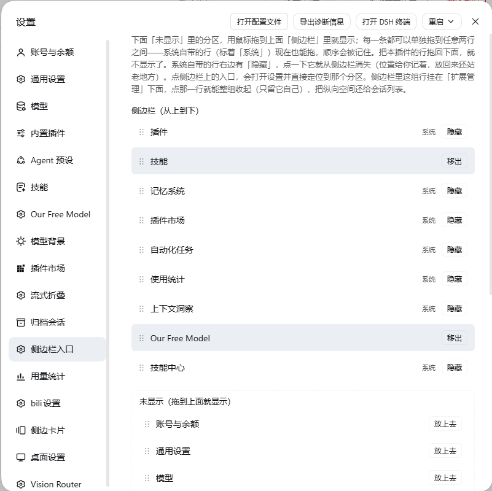
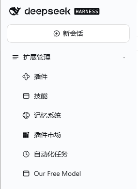

# 侧边栏入口 · dsh-visibility

[](https://github.com/zqdomo/dsh-visibility/actions/workflows/test.yml)
[](./LICENSE)

**简体中文** · [English](#english)



---

## 简体中文

给 DSH 的左侧边栏加一个「入口管理器」：把设置里的任意分区变成侧边栏直达按钮，把侧边栏每一行（**包括系统自带的「插件」「任务」**）随意拖动排序、单独隐藏、整组收起。

纯客户端插件，不碰后端、不改数据库、不劫持 React 的渲染顺序——状态全部存在浏览器 `localStorage`，删掉目录就干净复原。

### 它能干什么

| 能力 | 说明 |
| --- | --- |
| **分区直达** | 设置里的每个分区（技能、模型、插件…）都能勾选成侧边栏入口，点一下直接打开设置并定位到那个分区 |
| **自由排序** | 侧边栏每一行都能拖，上拖下拖都行；系统自带的「插件」「任务」也照拖不误 |
| **单行隐藏** | 任何一行都能藏起来，**位置记着**——以后再点「显示」，它回到原来站的地方，不会跑到队尾 |
| **整组收起** | 一个「收起/展开」按钮把这一组入口折起来，只留一行标题，不占会话列表的地盘 |
| **一键还原** | 面板底部有「全部恢复显示」，误操作也能救回来 |
| **老数据迁移** | 自动识别并迁移 v1 / v2 / v3 版本的存储格式，升级不丢配置 |

### 怎么用



1. 打开设置：点左下角头像，或按 `Ctrl + ,`
2. 左栏最下面找到 **「侧边栏入口」**
3. 面板分两块：
   - 上半块是**已经上到侧边栏的行**（顺序就是侧边栏的实际顺序）——拖动调整位置；系统自带的行右侧是「隐藏」（位置记住，随时放回来），自己添加的分区右侧是「移出」（摘回下面的候选区）
   - 下半块是**还没上来的设置分区**——点一下「放上去」就挂到侧边栏
4. 侧边栏上直接拖也行：拖到某一行的上半部分是插到它前面，下半部分是插到它后面
5. 侧边栏顶部那行「收起」能整组折叠

> 状态存在 `localStorage` 的 `dsh-sidebar-links.v4` 键里。换浏览器 profile 或换设备不会同步，属于预期行为。

### 安装

本插件的包名是 `@local/dsh-visibility`（保留 `@local` 前缀是为了兼容本地 `link:` 安装方式，不影响从 GitHub 安装）。

#### 方式一：从 GitHub 安装（推荐给其他人）

编辑你的 DSH profile 配置 `~/.dsh/profiles/<profile>/package.json`，在 `dependencies` 里加一行：

```json
"@local/dsh-visibility": "git+https://github.com/zqdomo/dsh-visibility.git"
```

再把包名加进同一文件的 `dsh.profile.bundles` 数组：

```json
"dsh": {
  "profile": {
    "bundles": [
      "...",
      "@local/dsh-visibility"
    ]
  }
}
```

然后在 `~/.dsh/profiles/<profile>/` 下执行一次 `npm install`（或 `pnpm install`），重启 DSH。

#### 方式二：本地开发安装

把仓库克隆到任意目录，然后用 `link:` 指过去：

```json
"@local/dsh-visibility": "link:D:/path/to/dsh-visibility"
```

同样要加进 `dsh.profile.bundles`，重启 DSH 生效。

#### 卸载

从 `dependencies` 和 `dsh.profile.bundles` 里删掉那两行，重启即可。`localStorage` 里残留的键可以手动清掉，不清也没影响。

### 原理（为什么这么做）

DSH 的设置弹窗开关状态由 `settings-general` 包内私有的 store 持有，没有对外服务；`settings.open` 命令在桌面端只走原生键盘分发，合成 `KeyboardEvent` 无效。所以本插件不去「叫开」设置，而是走**真实 UI 路径**：

```
账号菜单按钮 (button[aria-haspopup="menu"])
  → 菜单项「设置」(button[role="menuitem"])
    → 弹窗 [data-shortcut-modal="settings"] 里的分区 navCell
```

三步都是真实 DOM，点出来的就是用户自己点出来的效果。

**排序**不改 DOM 顺序：侧边栏列表是 `display:flex; flex-direction:column`，插件给每一行写 CSS `order`，视觉顺序随便排，React 对此一无所知，也就永远不会把顺序改回去。

**隐藏**用行内 `display:none`，React 只认自己的 props，不会去清 `style.display`。

**热替换安全**：每次加载发一个递增的实例代次（`window.__dshVisibilityGen`），不是最新代次的实例自动停摆，避免热更新后两个实例抢点击。

### 已知限制

- 依赖 DSH 当前的 DOM 结构（aria-label、`data-shortcut-modal` 等）。DSH 大改版后可能失效，届时改 `client.js` 顶部的选择器常量即可。
- 只在客户端（Web / 桌面端 WebView）生效，Host 侧是空 `apply()`，不注册任何能力。
- 配置按浏览器存储，不同步、不共享。
- 侧边栏极窄（rail 模式）时入口会被压成方块图标，这是跟随系统行宽度的结果。

### 开发

```
dsh-visibility/
├── index.js              # Host 半边：空 apply()，只为让 Loader 认领本包
├── client.js             # 客户端半边：全部逻辑（约 1500 行，含大段设计注释）
├── cordis.patch.yml      # Loader patch：把本包插进插件树
├── package.json
├── docs/                 # 截图
└── tests/
    ├── order.test.cjs         # 顺序表纯函数测试（迁移、补全、移动下标）
    └── apply-order.test.cjs   # applyOrder 的假 DOM 测试
```

跑测试（不需要装依赖，纯 Node）：

```bash
npm test
# 等价于
node tests/order.test.cjs && node tests/apply-order.test.cjs
```

测试的做法是从 `client.js` 里**按标记/函数签名原文抽出**要测的代码块再跑，所以改了实现也不会因为行号变化而失效；代价是那些标记注释（`const SYS = 'sys:'`、`持久化`、函数签名）不能随手删。

改客户端代码时记住 DSH 的热更新特性：`client.js` 被替换后旧实例不会销毁，所以任何新增的全局监听都要挂上代次判断。

### License

[MIT](./LICENSE) © 2026 zqdomo

---

## English

[简体中文](#简体中文) · **English**

A sidebar entry manager for DSH: turn any settings section into a one-click sidebar entry, and reorder, hide, or collapse **every row of the sidebar — including the built-in "Plugins" and "Tasks" rows**.

Client-side only. No backend, no database, no fighting React's render order. All state lives in `localStorage`, so deleting the folder restores everything cleanly.

### What it does

| Capability | Detail |
| --- | --- |
| **Section shortcuts** | Pick any settings section (Skills, Models, Plugins…) and pin it to the sidebar. One click opens Settings and jumps straight to that section |
| **Drag to reorder** | Every row is draggable, including built-in rows like "Plugins" and "Tasks" |
| **Hide a row** | Any row can be hidden. Its **position is remembered** — show it again and it returns to where it was, not to the bottom |
| **Collapse the group** | One "Collapse / Expand" toggle folds the whole group into a single header line, giving the space back to your session list |
| **Restore all** | A "Show all" button at the bottom of the panel undoes accidental hiding |
| **Migration** | Automatically detects and migrates the v1 / v2 / v3 storage formats |

### Usage

1. Open Settings: click your avatar in the bottom-left corner, or press `Ctrl + ,`
2. Find **"Sidebar Entries"** at the bottom of the left nav
3. The panel has two parts:
   - **Top:** rows currently on the sidebar, in their actual order. Drag to reorder. Built-in rows offer "Hide" — the position is remembered, so it returns to the same spot later. Sections you pinned offer "Remove", which sends them back to the list below
   - **Bottom:** settings sections that are not on the sidebar yet. Click "Add" to pin one
4. You can also drag directly on the sidebar: drop on the upper half of a row to insert before it, lower half to insert after
5. The header row at the top of the group collapses everything

> State is stored in `localStorage` under the key `dsh-sidebar-links.v4`. It does not sync across browser profiles or machines — that is intended.

### Installation

The package name is `@local/dsh-visibility`. The `@local` prefix exists so that a local `link:` install keeps working; it does not affect installing from GitHub.

#### Option 1: Install from GitHub (for everyone else)

Edit your DSH profile config at `~/.dsh/profiles/<profile>/package.json` and add one line to `dependencies`:

```json
"@local/dsh-visibility": "git+https://github.com/zqdomo/dsh-visibility.git"
```

Then add the package name to `dsh.profile.bundles` in the same file:

```json
"dsh": {
  "profile": {
    "bundles": [
      "...",
      "@local/dsh-visibility"
    ]
  }
}
```

Run `npm install` (or `pnpm install`) inside `~/.dsh/profiles/<profile>/`, then restart DSH.

#### Option 2: Local development

Clone the repo anywhere and point `link:` at it:

```json
"@local/dsh-visibility": "link:/path/to/dsh-visibility"
```

Add it to `dsh.profile.bundles` as well, then restart DSH.

#### Uninstall

Remove those two entries and restart. Leftover `localStorage` keys can be cleared by hand; leaving them does no harm.

### How it works

The Settings modal's open state is held by a private store inside the `settings-general` package, with no public service. The `settings.open` command on desktop is dispatched through native keyboard handling only, so a synthetic `KeyboardEvent` does nothing. This plugin therefore does not try to "call" Settings open — it walks the **real UI path**:

```
account menu button (button[aria-haspopup="menu"])
  → menu item "Settings" (button[role="menuitem"])
    → section navCell inside [data-shortcut-modal="settings"]
```

All three are real DOM nodes, so the result is exactly what a user clicking through would see.

**Reordering** never touches DOM order. The sidebar list is `display:flex; flex-direction:column`, so the plugin writes a CSS `order` value on each row. Visual order becomes arbitrary while React remains unaware of it — which means React can never put the order back.

**Hiding** sets an inline `display:none`. React only trusts its own props and will not clear `style.display`.

**Hot-reload safety:** every module load bumps a generation counter (`window.__dshVisibilityGen`). Instances that are not the newest shut themselves down, so a hot-replaced `client.js` cannot leave two copies fighting over clicks.

### Known limitations

- Depends on the current DSH DOM structure (aria-labels, `data-shortcut-modal`, …). A major DSH redesign may break it; the fix is to update the selector constants at the top of `client.js`.
- Client-side only (Web / desktop WebView). The host side is an empty `apply()` that registers no capabilities.
- Configuration is per-browser: no sync, no sharing.
- In a very narrow sidebar (rail mode), entries are squeezed into square icons because they follow the built-in row width.

### Development

```
dsh-visibility/
├── index.js              # host half: empty apply(), only so the Loader claims the package
├── client.js             # client half: all the logic (~1500 lines, heavily commented)
├── cordis.patch.yml      # Loader patch that inserts this package into the plugin tree
├── package.json
├── docs/                 # screenshots
└── tests/
    ├── order.test.cjs         # pure functions for the order table (migration, completion, move index)
    └── apply-order.test.cjs   # applyOrder against a fake DOM
```

Run the tests (plain Node, no dependencies to install):

```bash
npm test
# same as
node tests/order.test.cjs && node tests/apply-order.test.cjs
```

The tests extract the code under test **verbatim out of `client.js`** by marker comment or function signature, then run it. Implementation edits therefore never break the tests through shifting line numbers — the tradeoff is that those marker comments (`const SYS = 'sys:'`, `持久化`, the function signatures) must not be deleted casually.

When changing client code, keep DSH's hot-reload behaviour in mind: replacing `client.js` does not dispose the old instance, so any new global listener needs a generation guard.

### License

[MIT](./LICENSE) © 2026 zqdomo
